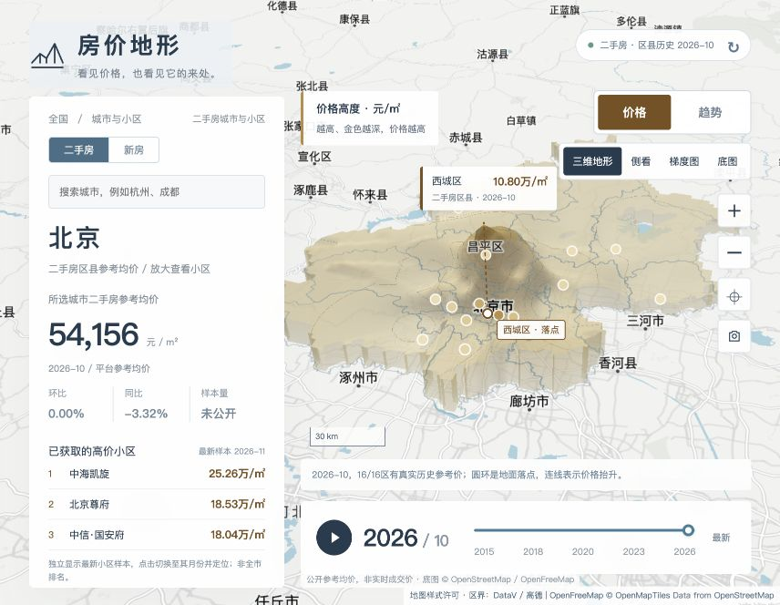
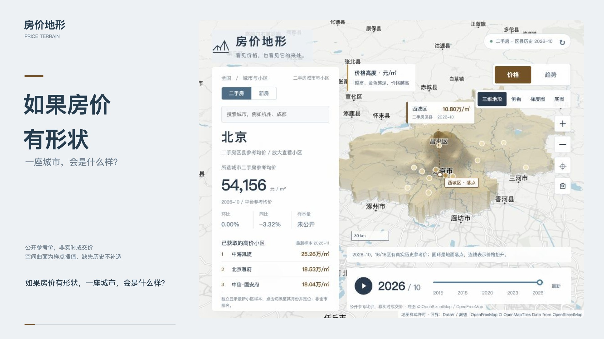
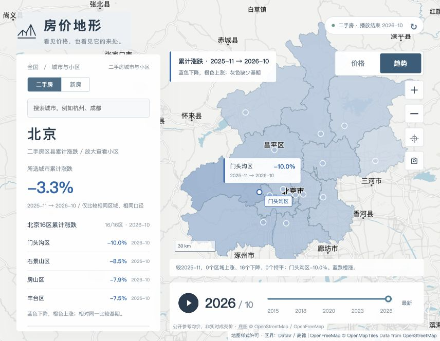

# Price Terrain · 房价地形

**What would a city look like if housing prices had a shape?**

Explore reference housing prices on a real map. Read price levels as continuous 3D terrain, then play monthly history to see regional changes.

[中文](README.md) · [Demo video](docs/media/price-terrain-promo.mp4) · [Contributing](CONTRIBUTING.md)



[](docs/media/price-terrain-promo.mp4)

## Two views, two questions

- **Price:** height and a sequential gold palette represent reference unit prices. Inspect the terrain from the side or overhead; ground markers identify the actual sample locations.
- **Trend:** an overhead map shows cumulative percentage changes against an explicit baseline. Blue means falling, orange means rising. Missing baselines are gray, not zero.

Playback preserves the selected view and compares trend frames against one fixed starting month. New and resale homes have separate sources, caches and histories. Viewport-based loading uses browser IndexedDB and server-side D1 caches.



## Data scope matters

These are **public reference / listing prices, not live transaction prices**. The national report adapter locates 69 cities, with 33 additional verified directory entries; actual successful coverage varies by month and source availability. Beijing has district-level history. Community records are partial public samples, not a complete nationwide historical database.

The surface interpolates observations of the same month and price type; it does not quote or estimate every location. Missing history stays missing. Every record retains its source, month and observation timestamp. See [data providers](docs/DATA_PROVIDER.md) and [third-party notices](THIRD_PARTY_NOTICES.md).

## Run locally

Requires Node.js **22.13+**, npm, WebGL and access to the public data/map services. No ChatGPT/Sites account or property-data API key is required.

```bash
git clone https://github.com/wangshande/price-terrain.git
cd price-terrain
npm ci
npm run db:migrate
npm run dev
```

Open [the local map](http://localhost:4173/atlas/index.html). Local D1 data lives in the ignored `.wrangler/state/` directory.

```bash
npm test
npm run typecheck
npm run build
npm start
```

## Deploy independently

1. Sign into your own Cloudflare account with `npx wrangler login`.
2. Run `npx wrangler d1 create price-terrain` and replace the placeholder `database_id` in `wrangler.jsonc`; choose a unique Worker name.
3. Run:

```bash
npm run db:migrate -- --remote
npm run build
npx wrangler deploy --config dist/server/wrangler.json
```

Cloudflare quotas and charges apply to your own account. Do not commit credentials.

## Contribute

Useful contributions include licensed community-history providers, district coverage for more cities, performance improvements and accessibility. The source adapters may break when upstream pages change. Do not bypass access controls or invent missing observations.

Core UI: `public/atlas/`. APIs: `app/api/`. Data adapters and storage: `lib/market/`. Schema and migrations: `db/`, `drizzle/`.

## License

Original code is [MIT](LICENSE). MapLibre, basemap data, administrative boundaries and property-source material retain their own licenses and terms; they are not relicensed by this repository.
