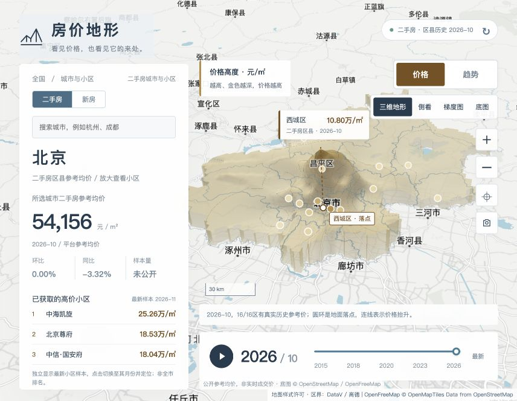
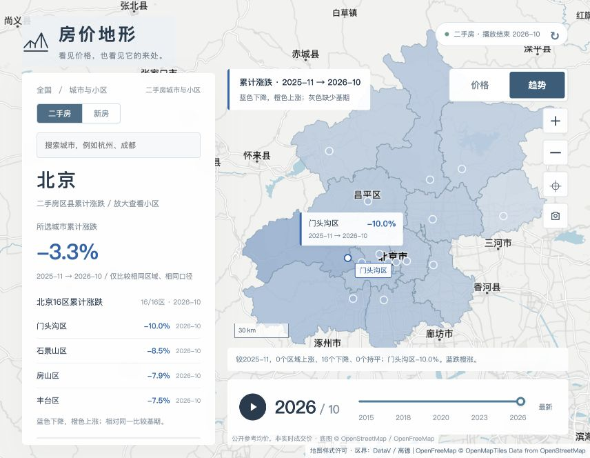

# 房价地形 · Price Terrain

**如果房价有形状，一座城市会是什么样？**

把城市参考房价放回真实地图，用三维山体看价格高低，用时间播放看区域变化。

[English](README.en.md) · [宣传视频](docs/media/price-terrain-promo.mp4) · [数据说明](docs/DATA_PROVIDER.md) · [参与贡献](CONTRIBUTING.md)



## 两张地图，回答两个问题

| 显示内容 | 你能看到什么 |
| --- | --- |
| **价格** | 连续三维山体。越高、金色越深，参考单价越高；支持侧看、俯视、起伏调节和真实地面落点。 |
| **趋势** | 相对同一基期的累计涨跌。蓝色下降、橙色上涨，标签、列表、图例统一为百分比；缺少基期标灰。 |

拖动月份或按下播放，从全局观察各区域的变化。播放保留你选的显示内容，趋势始终相对同一个播放起点。



- **真实底图**：道路、地名、水域来自 OpenStreetMap / OpenFreeMap。
- **逐层探索**：全国城市 → 北京16区 → 当前画面内已获取的小区样本。
- **按画面加载**：预取周边区域，浏览器 IndexedDB 与服务端 D1 缓存复用相邻视口。
- **新房 / 二手房独立**：分别采集、缓存、展示，不混算。
- **可核查的读数**：保留来源、数据月份、获取时间和挂牌/参考口径。
- **可扩展数据源**：可导入授权小区 JSON，预留小区历史数据提供器接口。

## 先说清数据边界

这是一个**房价空间可视化项目**。公开参考均价、挂牌均价均不等于实时成交价。

当前适配全国报告的69个可定位城市，另有33个已核实的补充城市入口；每次实际成功数量以界面为准。北京提供16区二手房月度历史，新房历史长度取决于来源。小区只展示成功获取、带有效坐标的部分公开样本，**尚未覆盖全国全量小区历史**。

曲面是同月、同口径样点的空间插值，不能当作曲面每个位置的实际报价或估值。历史缺口留空，不生成模拟历史；样本不足时保留底图。来源不可用时明确标记已有快照。详情见 [数据源与扩展](docs/DATA_PROVIDER.md)。

## 本地启动

需要 Node.js **22.13+**、npm，以及可访问底图和公开来源的网络。无需 ChatGPT、Sites 账号或房产 API 密钥。

```bash
git clone https://github.com/wangshande/price-terrain.git
cd price-terrain
npm ci
npm run db:migrate
npm run dev
```

打开 **http://localhost:4173/atlas/index.html**。本地数据库自动保存在 `.wrangler/state/`，不会上传 Git。

首次访问需要获取地图和公开价格；来源速度、访问限制及数据更新时间会影响结果。放大后仅请求当前可见范围，重复查看优先复用缓存。

## 检查与构建

```bash
npm test
npm run typecheck
npm run build
npm start
```

`npm start` 使用本地 Worker 和已构建静态资源。CI 在 Node.js 22 上运行测试、类型检查与构建。

## 自己部署到 Cloudflare

这是独立的 Cloudflare Workers + D1 工程，不依赖本项目作者的托管账号。

1. 执行 `npx wrangler login`，登录你自己的 Cloudflare。
2. 执行 `npx wrangler d1 create price-terrain`，将返回的数据库 ID 填入 `wrangler.jsonc` 中的 `database_id`；同时更换 Worker 的 `name`，避免名称冲突。
3. 执行迁移、构建、部署：

```bash
npm run db:migrate -- --remote
npm run build
npx wrangler deploy --config dist/server/wrangler.json
```

Cloudflare 账号的配额和费用以你自己的套餐为准。不要提交任何账号令牌；这份仓库只含本地占位数据库 ID。

## 结构

```text
public/atlas/           地图 UI、WebGL 曲面、Worker、视口缓存
app/api/                价格、城市、区县、小区与视口接口
lib/market/             公开来源解析、数据提供器、D1 仓储
 db/、drizzle/           数据表与迁移
 tests/                 价格解析、数据隔离、地形和缓存测试
 docs/                  数据说明、截图、演示视频
```

## 接口

| 路径 | 用途 |
| --- | --- |
| `/api/market?month=YYYY-MM` | 全国二手房城市报告 |
| `/api/market-extra?month=YYYY-MM&offset=0` | 分批补充城市 |
| `/api/city?city=北京` | 城市历史 |
| `/api/districts?city=北京&month=YYYY-MM` | 北京16区与真实边界 |
| `/api/viewport?city=北京&bbox=116.3,39.84,116.55,40.04&month=latest` | 按范围加载小区缓存；`collect=1` 增量采集 |
| `/api/community?city=北京&id=...` | 小区公开详情与已采集历史 |
| `/api/new-homes?scope=national&month=YYYY-MM&offset=0` | 独立的新房城市数据 |
| `/api/new-homes?scope=district&city=北京&month=YYYY-MM` | 独立的新房区县数据 |
| `/api/coverage` | 数据库实际覆盖和采集状态 |

所有价格历史只记录真实来源月份。当前使用公开页面适配器，网站结构变化可能导致解析失效；不绕过验证码、登录墙或访问限制。

## 接下来一起做

欢迎带来**有授权的小区历史数据提供器**、更多城市的区级覆盖、更好的空间统计与可访问性改进。提交前请看 [CONTRIBUTING.md](CONTRIBUTING.md)。

## 许可证与署名

项目自有代码采用 [MIT](LICENSE)。MapLibre、底图、行政边界、房价来源资料遵循各自许可，**不因代码开源而变更授权**。完整说明见 [第三方声明](THIRD_PARTY_NOTICES.md)。
